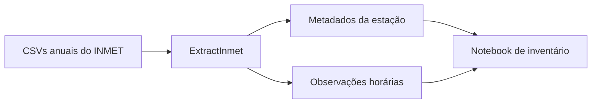

# ClimateLab

O ClimateLab investiga como temperatura, umidade e chuva variam ao longo do tempo e como as lacunas de observação afetam a identificação de extremos e períodos secos. A primeira etapa é a leitura das séries horárias de estações automáticas do Instituto Nacional de Meteorologia (INMET).

## O que já funciona

O pacote Python localiza os CSVs de um ano, identifica cada arquivo pela estação e pelo ano do nome e lê metadados e medições em tabelas pandas. A leitura pode ser individual ou em lote, um arquivo por vez. O notebook de inventário mostra os metadados e uma amostra das medições da estação A620 em 2024.



## Execução local

Com Python 3.14 e uv, execute na raiz do repositório.

```bash
uv sync --locked
uv run --locked pytest -q
```

A suíte usa CSVs temporários e inclui contratos de validação ainda pendentes. Para explorar dados reais, coloque os CSVs do INMET diretamente em `data/raw/inmet/2024/`, inicie o JupyterLab com `uv run --locked jupyter lab` e abra o inventário. [Guia de preparação](docs/preparacao.md) · [Notebook de inventário](notebooks/01-inventario.ipynb)

## Próximas etapas

O planejamento inclui validar a estrutura dos arquivos, medir a cobertura das séries e calcular indicadores de temperatura e precipitação. A comparação das observações com a reanálise ERA5 via Open-Meteo depende da implementação da coleta e do alinhamento espacial e temporal entre as fontes.

## Documentação

- [Arquitetura](docs/arquitetura.md) — interfaces de leitura, organização dos dados e comportamento diante de falhas.
- [Fontes meteorológicas](docs/fontes.md) — formato dos CSVs, unidades e limites da comparação com ERA5.
- [Testes](tests/README.md) — execução da suíte e contratos verificados.
