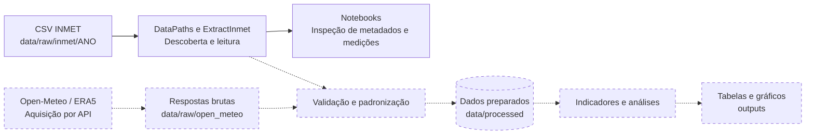

# ClimateLab

Laboratório pessoal de investigação ambiental e análise de dados meteorológicos com Python.

O ClimateLab organiza séries de temperatura, umidade relativa e precipitação
para investigar sua variação no tempo. O processamento começa com arquivos
históricos de estações automáticas do INMET e será ampliado gradualmente para
outras fontes, como a reanálise ERA5 obtida pelo Open-Meteo.

O projeto está na etapa de extração dos arquivos locais. A padronização, o
diagnóstico de qualidade e as análises reutilizáveis serão construídos em etapas.

## Perguntas de investigação

O recorte inicial é uma estação, o ano de 2024 e três variáveis:

- Como temperatura, umidade e chuva variam ao longo dos dias e meses?
- Quais extremos, episódios quentes e sequências de dias secos aparecem nos registros?
- Como lacunas e regras de cobertura afetam os indicadores?
- Que relações estatísticas existem entre as variáveis?
- Em que condições observações de estações e estimativas de reanálise podem ser comparadas?

Cada análise deverá apresentar dados, método, hipóteses e limitações. Um único
ano não constitui uma normal climatológica; correlação não demonstra causalidade.
Investigar diferenças entre períodos também não basta para atribuí-las a mudanças
climáticas ou urbanização.

## Fontes de dados

- **INMET:** observações de estações automáticas. O pacote de 2024 está disponível
  no ambiente local, com o ZIP original e 565 CSVs, ignorados pelo Git.
- **Open-Meteo / ERA5:** reanálise em grade prevista para comparação por API.
  O cliente e a integração ainda não foram implementados.

O acervo de CSVs precisa ser obtido separadamente. O notebook de inventário
inclui uma prévia salva da estação A620. Consulte [fontes e formatos](docs/fontes.md)
e o [guia de preparação local](docs/preparacao.md).

## Arquitetura e fluxo dos dados



As linhas contínuas mostram a descoberta e a leitura disponíveis hoje.
O tracejado indica as próximas etapas do projeto.

Os originais ficam em `data/raw/`. `data/processed/`, `outputs/figures/` e
`outputs/tables/` contêm apenas marcadores de diretório e estão reservados para
dados preparados e resultados.

## Estado da implementação

### Implementado

- `DataPaths.csv_paths(year)` lista os CSVs de um ano em ordem de caminho,
  aceitando variações de maiúsculas e minúsculas na extensão.
- `ExtractInmet.inmet_paths()` produz pares de identificador estação/ano e caminho.
- `ExtractInmet.inmet_metadata(file)` lê as oito primeiras linhas em duas colunas.
- `ExtractInmet.inmet_dataframe(file)` lê as medições com separador `;`,
  codificação Latin-1 e vírgula decimal, após as oito linhas iniciais.
- `ExtractInmet.inmet_dataframes()` retorna identificador, caminho e DataFrame
  por arquivo, carregando cada tabela conforme o iterador é consumido. Quando a
  leitura de medições lança uma exceção, o lote registra o problema por caminho
  em `registry_erros` e passa ao arquivo seguinte.
- `ColumnName` reúne 19 nomes de colunas, sem converter ou validar valores.

### Em desenvolvimento

O notebook de inventário exibe os metadados e as primeiras 100 observações de
A620 em 2024. O inventário e a interpretação ainda estão em andamento.
[Inspeção da estação A620](notebooks/01-inventario.ipynb)

O notebook de teste experimenta uma listagem interativa. A célula atual
termina após o primeiro arquivo para ambas as respostas, `0` e `1`.
[Experimento de listagem](notebooks/teste.ipynb)

O extrator ainda presume o formato do nome e do cabeçalho. Um nome curto pode
interromper o lote antes da leitura. Em leituras diretas, erros do parser podem
resultar em `UnboundLocalError`. Em 19/11/2026, **29 de 60 testes passaram** e
31 falharam em cenários de preservação de texto, validação estrutural e
diagnóstico. [Contrato e resultado da suíte](tests/README.md#estado-da-suíte)

### Planejado

Aquisição por API, normalização temporal, diagnóstico de qualidade, regras de
cobertura, indicadores, episódios, comparações entre fontes e uma engine de
análise reutilizável. Ainda não há resultados científicos consolidados.

## Decisões técnicas

- A leitura separa metadados e medições para manter a identificação da estação
  disponível durante a investigação. Os parâmetros atuais correspondem ao formato
  inspecionado; outros arquivos e anos exigem conferência.
- O iterador lê um arquivo por vez, evitando carregar todas as tabelas juntas.
  Cada CSV ainda é lido integralmente; desempenho em grande escala não foi medido.
- Dados brutos, dados preparados e resultados têm destinos separados para
  permitir rastrear as transformações. Dados e resultados permanecem locais.
- A implementação fica em `src/climatelab/`; os notebooks servem à exploração.
  O planejamento prevê funções reutilizáveis antes de uma interface de engine.
- O ambiente é definido por `pyproject.toml` e fixado em `uv.lock`, para reproduzir
  as dependências com `uv sync --locked`.

## Tecnologias

Python e pandas sustentam a leitura atual. JupyterLab e ipykernel permitem a
exploração em notebooks; pytest verifica descoberta, leitura e requisitos de
validação. NumPy, Matplotlib, Seaborn, httpx e PyArrow já estão no ambiente,
mas sua instalação não representa análises, gráficos, cliente HTTP ou exportação
colunar implementados.

## Execução local

O projeto requer Python `>=3.14,<3.15`; `.python-version` fixa `3.14.4`.
Com o [uv](https://docs.astral.sh/uv/) instalado, execute na raiz:

```bash
uv sync --locked
```

Antes de ler dados, obtenha os CSVs conforme o
[guia de preparação](docs/preparacao.md#obter-os-csvs-manualmente), preservando
os nomes originais em `data/raw/inmet/2024/`.

Este exemplo lê o primeiro arquivo na ordenação de caminhos:

```python
from climatelab.etl.extract import ExtractInmet

extractor = ExtractInmet(year=2024)
identifier, csv_path = next(extractor.inmet_paths())
metadata = extractor.inmet_metadata(csv_path)
observations = extractor.inmet_dataframe(csv_path)
print(identifier, metadata.shape, observations.shape)
```

Uma pasta de ano inexistente gera `FileNotFoundError`. Um arquivo no lugar da
pasta gera `NotADirectoryError`. Em uma pasta sem CSVs, o `next()` do exemplo
gera `StopIteration`. Para selecionar uma estação, confira os identificadores
retornados por `inmet_paths()`, que ainda podem se repetir.

Para abrir os notebooks ou executar os testes:

```bash
uv run --locked jupyter lab
uv run --locked pytest
```

Use a raiz como diretório de trabalho, pois os caminhos padrão são relativos.
No VS Code, `.vscode/settings.json` configura essa raiz para os notebooks e
aponta o interpretador para `.venv/bin/python`. Selecione esse ambiente também
como kernel. O registro opcional de um kernel com nome próprio está no
[guia de preparação](docs/preparacao.md#requisitos-do-ambiente).

## Estrutura do repositório

```text
ClimateLab/
├── data/
│   ├── raw/inmet/              # Originais locais: 2024.zip e 2024/*.CSV
│   ├── raw/open_meteo/         # Reservado para respostas da API
│   └── processed/              # Reservado para dados preparados
├── docs/
│   ├── desafios.md             # Planejamento de 30 investigações e requisitos
│   ├── fontes.md               # Referências, formatos e atribuição
│   └── preparacao.md           # Ambiente, aquisição e verificações
├── notebooks/
│   ├── 01-inventario.ipynb     # Inspeção inicial em andamento
│   └── teste.ipynb             # Experimento de listagem interativa
├── outputs/
│   ├── figures/                # Reservado para gráficos
│   └── tables/                 # Reservado para tabelas de resultados
├── src/climatelab/
│   ├── __init__.py
│   ├── etl/extract.py          # Leitura bruta de CSVs INMET
│   ├── exceptions/
│   │   └── inmet_exception.py  # Classes de erro em desenvolvimento
│   └── utils/
│       ├── columns_name.py
│       └── data_paths.py
├── tests/                     # Cenários de leitura e validação
├── .python-version
├── pyproject.toml
├── uv.lock
└── README.md
```

## Roadmap

As etapas abaixo definem entregáveis verificáveis. Apenas a leitura inicial da
primeira etapa está implementada; sua conclusão depende de qualidade e cobertura.

1. **Leitura e qualidade (01–06):** inventário, metadados estruturados,
   diagnóstico de registros, cobertura por variável e indicadores diários com
   regras explícitas de elegibilidade.
2. **Integração de fontes (07–12):** cliente HTTP com persistência, respostas
   normalizadas, correspondência espacial e temporal auditada e medidas de divergência.
3. **Padrões e eventos (13–20):** perfis temporais, investigação de extremos,
   sequências secas, episódios quentes e probabilidades com denominadores conhecidos.
4. **Modelos matemáticos (21–24):** funções e simulações com hipóteses, limites
   e tolerâncias documentados, separados das observações meteorológicas.
5. **Engine, incerteza e escala (25–30):** interface reutilizável, reamostragem,
   sensibilidade a parâmetros, comparação entre períodos, medição de desempenho
   e relatório ambiental rastreável.

Os [30 desafios de investigação](docs/desafios.md) detalham requisitos, métodos
e critérios científicos. A comparação entre fontes exige compatibilidade de
unidades, localização, fuso, intervalos de precipitação e cobertura. Essas
condições deverão ser demonstradas antes de interpretar as diferenças.
