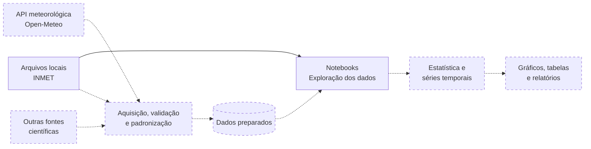

# ClimateLab

**Laboratório de investigação ambiental com Python, estatística e ciência de dados.**

O ClimateLab combina programação, matemática e exploração de dados meteorológicos
para investigar **temperatura, umidade relativa e precipitação**. O desenvolvimento
é incremental: parte de observações do INMET e prevê ampliar as investigações
com arquivos locais e APIs de outras fontes, como o Open-Meteo.

## Objetivo da investigação

O recorte inicial é **uma estação, o ano de 2024 e três variáveis**. As perguntas
orientam o estudo:

- Como temperatura, umidade e chuva variam ao longo do tempo?
- Quais padrões, extremos e períodos secos aparecem nos registros?
- Que relações estatísticas existem entre as variáveis?
- Em que condições dados de fontes diferentes podem ser comparados?

Cada análise deve explicitar a qualidade e a cobertura dos dados, o método,
as hipóteses e os limites das conclusões. Um único ano não constitui uma normal
climatológica, e uma associação estatística não demonstra causalidade.

## Arquitetura e fluxo dos dados

As fontes alimentam a investigação em notebooks. O desenho abaixo apresenta
esse fluxo e sua evolução prevista, da aquisição às conclusões científicas.



**Fluxo atual (seta contínua):** leitura de arquivos INMET no notebook, apoiada
por `DataPaths` e `ColumnName`. **Evolução planejada (setas e contornos tracejados):**
novas fontes, preparação, análises e resultados. O diagrama representa o fluxo
dos dados; os módulos implementados estão descritos no estado atual e na estrutura
do repositório.

Os originais ficam em `data/raw/`. `data/processed/` e `outputs/` são diretórios
reservados para dados preparados e resultados; atualmente contêm apenas marcadores
de diretório.

## Estado atual

| Componente | Situação |
| --- | --- |
| Ambiente Python e Jupyter | Dependências fixadas em `uv.lock`; configuração do VS Code disponível |
| Dados INMET de 2024 | ZIP e 565 CSVs presentes no ambiente local; não versionados |
| Seleção de arquivos | `DataPaths.csv_path()` localiza um CSV por estação e ano |
| Nomes de colunas | `ColumnName` centraliza 19 nomes; não converte nem valida dados |
| Notebook de inventário | Leitura e seleção de colunas implementadas; inventário e interpretação em andamento |
| APIs, validação, indicadores e engine | Planejados; ainda não implementados |

O trabalho está no início da etapa 1. A disponibilidade dos arquivos e a leitura
no notebook não comprovam a qualidade ou a cobertura das séries.

## Jornada dos 30 desafios

A trilha desenvolve habilidades de Python, estatística, probabilidade e
modelagem matemática a partir de perguntas ambientais. **As etapas abaixo são
objetivos de aprendizagem, não funcionalidades concluídas.**


Os [30 enunciados e critérios de conclusão](docs/desafios.md) orientam a
investigação, a conferência dos cálculos e a interpretação científica.
Escala, desempenho e conclusões ambientais permanecem metas a demonstrar.

## Começar no ambiente local

O projeto requer **Python 3.14** (`>=3.14,<3.15`); `.python-version` fixa
**3.14.4**. Com o [uv](https://docs.astral.sh/uv/) instalado, execute na raiz:

```bash
uv sync --locked
uv run --locked jupyter lab
```

Abra [notebooks/01-inventario.ipynb](notebooks/01-inventario.ipynb). No VS Code,
selecione `.venv/bin/python` como interpretador e como ambiente do kernel.
Se precisar registrar um kernel com nome próprio:

```bash
uv run --locked python -m ipykernel install --sys-prefix --name climatelab --display-name "ClimateLab (.venv)"
```

Execute o notebook com a raiz do repositório como diretório de trabalho,
conforme a configuração em `.vscode/settings.json`.

**Dependências:** pandas, NumPy, Matplotlib, Seaborn, JupyterLab, ipykernel,
PyArrow e httpx. A presença de httpx e PyArrow no ambiente prepara os próximos
exercícios; cliente HTTP e processamento colunar ainda não foram desenvolvidos.

### Dados e utilitários

Os dados não acompanham o clone. Para o notebook inicial, os CSVs de 2024 devem
estar em `data/raw/inmet/2024/`, preservando os nomes originais. Consulte
[fontes e aquisição](docs/fontes.md) e o [registro de preparação](docs/preparacao.md).

Os imports usam o pacote instalado `climatelab`:

```python
from climatelab.utils.columns_name import ColumnName
from climatelab.utils.data_paths import DataPaths

csv_path = DataPaths().csv_path("A009", year=2024)
temperature_column = ColumnName().temperatura_do_ar_bulbo_seco_horaria
```

`csv_path()` exige exatamente uma correspondência: ausência ou ambiguidade gera
`ValueError`; uma pasta de ano inexistente gera `FileNotFoundError`. Os parâmetros
de leitura usados no notebook devem ser conferidos para outros arquivos e anos.

## Estrutura do repositório

```text
ClimateLab/
├── data/
│   ├── raw/inmet/              # Originais locais: 2024.zip e 2024/*.CSV
│   ├── raw/open_meteo/         # Reservado para futuras respostas da API
│   └── processed/              # Reservado para dados preparados
├── docs/
│   ├── assets/                 # SVGs originais preservados
│   ├── desafios.md             # 30 desafios e critérios científicos
│   ├── fontes.md               # Procedência, aquisição e atribuição
│   └── preparacao.md           # Histórico da preparação local
├── notebooks/
│   └── 01-inventario.ipynb     # Investigação inicial em andamento
├── outputs/
│   ├── figures/                # Reservado para gráficos
│   └── tables/                 # Reservado para tabelas de resultados
├── src/climatelab/
│   ├── __init__.py
│   └── utils/
│       ├── columns_name.py
│       └── data_paths.py
├── .python-version
├── pyproject.toml
├── uv.lock
└── README.md
```

## Fontes e rigor científico

- **INMET:** observações de estações automáticas; primeira fonte utilizada.
- **Open-Meteo / ERA5:** reanálise em grade prevista para comparação por API;
  integração ainda não implementada.

Observações de estações e estimativas de reanálise são produtos distintos.
Compará-los exige conferir localização, unidades, referência temporal e cobertura.
Ausência de medição e precipitação zero também precisam de tratamentos distintos.

Reprodutibilidade e rastreabilidade orientam o estudo: preservar originais,
registrar fontes, parâmetros e transformações, e justificar limiares e regras de
cobertura. Referências, atribuições e condições de uso estão em
[docs/fontes.md](docs/fontes.md); cada fonte mantém suas próprias condições.
