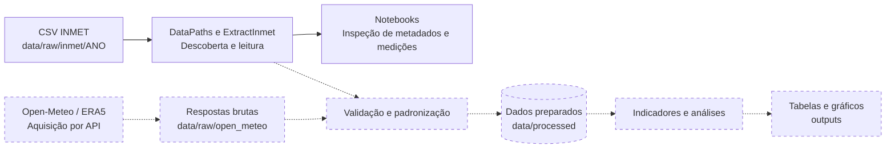

# Desenvolvimento do ClimateLab

O código reutilizável fica em `src/climatelab/`, e os notebooks servem à
exploração. A trilha de investigação detalha os critérios de qualidade,
cobertura e análise que orientam a implementação. [Planejamento](desafios.md)

## Arquitetura e fluxo dos dados



As linhas contínuas mostram o fluxo implementado. O tracejado indica as
etapas planejadas.

## Extração do INMET

| Interface | Comportamento atual |
| --- | --- |
| `DataPaths.csv_paths(year)` | Lista os CSVs da pasta anual em ordem de caminho, aceitando variações de caixa na extensão. |
| `ExtractInmet.inmet_paths()` | Produz pares de identificador estação/ano e caminho. |
| `ExtractInmet.inmet_metadata(file)` | Lê as oito primeiras linhas em duas colunas. |
| `ExtractInmet.inmet_dataframe(file)` | Lê as medições após as oito linhas iniciais. |
| `ExtractInmet.inmet_dataframes()` | Produz identificador, caminho e tabela conforme o iterador é consumido. Registra exceções da leitura de medições em `registry_erros` e passa ao próximo arquivo. |
| `ColumnName` | Centraliza os nomes de 19 colunas de observações. |

O extrator presume a estrutura do nome e do cabeçalho. A validação de
identificadores e da estrutura deixa casos em aberto. Um nome curto pode
interromper o lote antes da leitura. Em leituras diretas, erros do parser
podem resultar em `UnboundLocalError`. As regras de diagnóstico e continuidade
do lote estão descritas na suíte.
[Formato do INMET](fontes.md#formato-e-leitura) · [Contrato dos testes](../tests/README.md)

## Decisões técnicas

- Ler metadados e medições separadamente mantém a identificação da estação
  disponível durante a investigação. Cada novo perfil histórico exige
  conferir o cabeçalho e os parâmetros de leitura.
- A iteração sob demanda carrega um CSV completo por vez. O desempenho em
  grande escala ainda precisa ser medido.
- Preservar os originais em `data/raw/` permite rastrear transformações.
  `data/processed/` recebe os dados preparados, e `outputs/tables/` e
  `outputs/figures/` são os destinos planejados para resultados.
- O planejamento começa com funções reutilizáveis antes de reunir a análise
  em uma interface de engine.
- `pyproject.toml` declara as dependências, e `uv.lock` fixa as versões
  instaladas por `uv sync --locked`. [Preparação do ambiente](preparacao.md#requisitos-do-ambiente)

## Histórico de desenvolvimento

### 19/11/2026 — Extração em lote e testes de estrutura

- O extrator passou a manter um registro de erros por caminho. A suíte foi
  revisada para cobrir estrutura dos CSVs, continuidade do lote e diagnóstico.
- O lockfile passou na verificação e as dependências instaladas estavam
  compatíveis. O SHA-256 do ZIP coincidiu com o registro de aquisição. Os
  565 CSVs tinham nomes e tamanhos correspondentes aos do ZIP. O arquivo de
  A001 também coincidiu byte a byte com a entrada do ZIP.
  [Verificação do acervo](preparacao.md#verificações-de-integridade-e-execução)
- O exemplo com A001 retornou metadados com dimensão `(8, 2)` e medições com
  dimensão `(8784, 20)`. O lote retornou 565 tabelas com `registry_erros` vazio.
  A leitura confirma o carregamento das tabelas. A auditoria de estrutura e
  cobertura das séries continua pendente.
- Os dois notebooks passaram na validação estrutural com `nbformat`. Em kernel
  local, o inventário com `nbclient` exibiu os metadados e as primeiras 100
  observações de A620. No experimento de listagem, entradas simuladas `0` e `1`
  encerraram a célula após o primeiro arquivo. A conferência na interface do
  VS Code ficou pendente. [Inventário](../notebooks/01-inventario.ipynb) ·
  [Experimento de listagem](../notebooks/teste.ipynb)
- A suíte teve **29 aprovações e 31 falhas em 60 cenários**, com seis falhas
  a mais que no código anterior. As seis resultaram de `UnboundLocalError`
  após erros do pandas em leituras diretas.
  [Resultado detalhado](../tests/README.md#estado-da-suíte)

### 15/11/2026 — Aquisição do acervo de 2024

A versão inicial do notebook de inventário foi validada com `nbformat` e
executada com `nbclient` a partir da raiz do projeto.

O download do ZIP pelo terminal falhou com encerramento da conexão pelo
destino, tanto no ambiente restrito quanto fora dele.

```text
ConnectionResetError: [Errno 104] Connection reset by peer
curl: (56) Recv failure: Connection reset by peer
http_code=000
size_download=0
```

O pacote foi adquirido manualmente e organizado no mesmo dia. O registro local
`data/raw/inmet/aquisicao-2024.json` conserva as tentativas, os nomes e
tamanhos dos CSVs, a comparação integral de A001 com o ZIP e a conferência de
dispositivo, inode, tamanho e data de modificação após a movimentação.

Na aquisição inicial, a inspeção se limitou às dez primeiras linhas de A001
em bytes, conforme o campo `csv_read_scope` no registro local.
